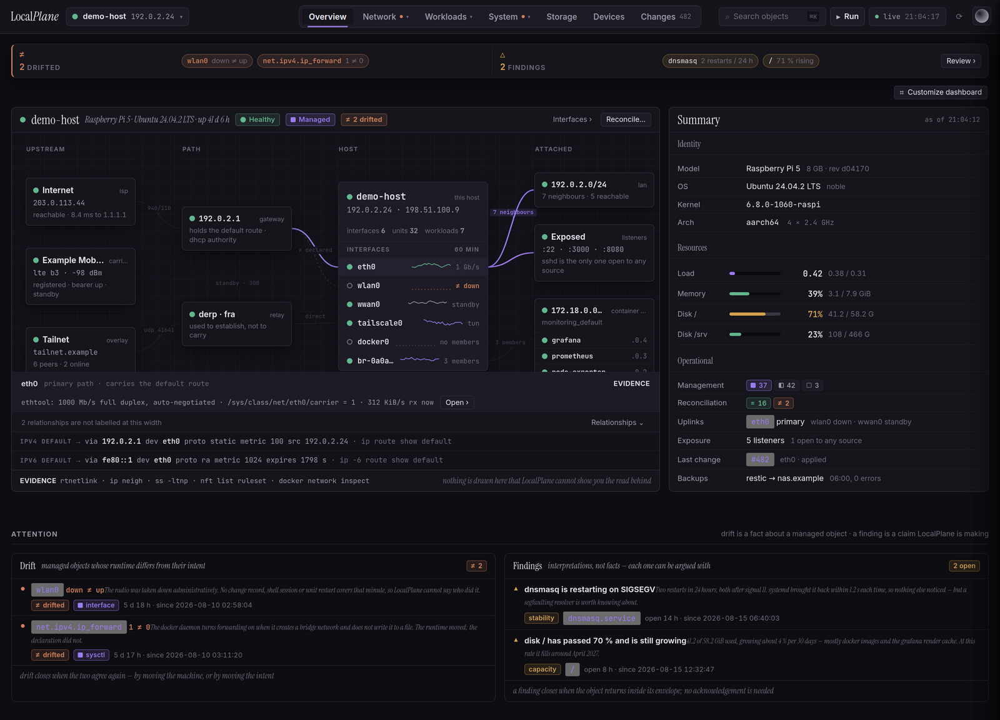
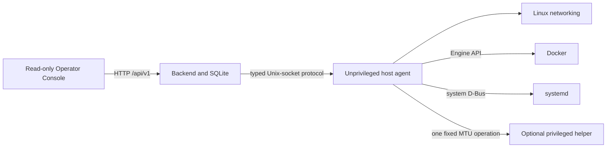

<div align="center">

<br>
<br>
<br>

<picture>
  <source media="(prefers-color-scheme: dark)" srcset="docs/images/localplane-wordmark-dark.svg">
  <source media="(prefers-color-scheme: light)" srcset="docs/images/localplane-wordmark-light.svg">
  
</picture>

<br>
<br>

**Observe everything. Manage what you choose.**

<br>

A local-first operations control plane for understanding Linux systems and making guarded,
evidence-backed changes.

<br>

</div>

> [!IMPORTANT]
> **Early development / pre-release.** LocalPlane is not production-ready. Its APIs, data
> model, packaging, and deployment requirements may change.

> [!WARNING]
> **Pre-release single-process operator console.** LocalPlane requires a locally initialized
> master credential. Plain-HTTP browser sessions are loopback development only. The supported
> non-loopback shape is a direct backend HTTPS listener serving one configured built console;
> it is not proxy deployment, public exposure, or a production-readiness claim.

LocalPlane turns provider facts into an operational model: identity, observation, evidence,
ownership, intent, findings, Runs, Changes, verification, recovery, and history. It respects
the system that owns each fact. Missing, stale, or incomplete evidence remains `unknown`;
LocalPlane does not convert uncertainty into a reassuring answer.

Linux is the first deeply supported platform, not the permanent conceptual boundary.



*V4.2 is product and interface direction, not a screenshot of the current application and
not a feature matrix. The implemented Operator Console includes limited systemd service
Composer controls and covers a subset of these surfaces.*

## Current capabilities

| Domain | Observation | Management |
| --- | --- | --- |
| Linux networking | Interfaces, addresses, link state, provider evidence, ownership, intent, reconciliation, provenance, and request-scoped route evidence | Adopt/release an eligible interface, revise retained intent, and reconcile the MTU of a managed interface |
| Docker | Containers, runtime state, configuration, ports, mounts, networks, health, bounded logs, and current statistics | Start, stop, or restart one validated container through the Docker Engine API |
| systemd | A bounded loaded-unit estate, unit state, enablement, typed relationships, service/socket/timer detail, lifecycle evidence, and LocalPlane containment | Start, stop, or restart one eligible loaded service through systemd's D-Bus API |
| Storage | On-demand mounted filesystem byte/inode availability and immediate kernel block backing; ext4/xfs sampling in the agent namespace (with namespace-handle mounts retained as unsupported), explicit partial/unsupported coverage | None; read-only investigation |
| Operational records | Observations, evidence, findings, Runs, Changes, verification, recovery, and history | Execute only a published and confirmed typed plan through the shared write path |

The backend has seven host-mutation operation types:

- `network.interface.reconcile_mtu`
- `docker.container.start`, `docker.container.stop`, `docker.container.restart`
- `systemd.service.start`, `systemd.service.stop`, `systemd.service.restart`

There is no generic command, shell, arbitrary Docker request, general D-Bus execution,
terminal, or provider passthrough surface.

The React/Vite Operator Console shows host overview, networking, workloads, systemd,
storage pressure, topology, Runs, Changes, and findings. Its read-only global palette searches observed objects
and bounded recent operational records, then opens their detail views. Authenticated systemd
service start/stop/restart uses the guarded Composer; Docker, MTU, Adopt and intent-revision
controls remain absent. Service recovery offers explicit non-mutating assessment, a separate
single-use grant and deliberate retry, or typed manual hold release without upgrading the
original outcome. Lost responses reattach to the same Run/Change through bounded reads,
never automatic write replay. See [project status](docs/project-status.md) for scope and limits.

The console distinguishes re-reading stored records from collecting provider evidence.
Network, System and Docker have explicit inventory observation controls; failed observations
do not make older evidence fresh. Overview includes unresolved recovery holds separately from
Findings, and inventory summaries distinguish latest-sighted membership from retained history.
Filesystem observations, container samples and sensitive log/journal reads require their own
controls; the global record reread does not repeat them.

## How a change works

```text
observe and collect evidence
  -> plan
  -> publish an immutable preview
  -> confirm
  -> execute through the owning provider
  -> observe again through the ordinary read path
  -> verify
  -> recover or hold for an operator when the outcome cannot be proved
```

A **Run** is the request and plan for one typed operation. A **Change** begins only when
execution enters a path on which a host write may occur; it is not proof that a write
occurred. Kernel, Docker, or systemd acceptance is not verified success. LocalPlane takes a
fresh observation and evaluates the evidence required by that operation.

## Architecture at a glance



The agent observes provider facts and executes closed provider operations. The backend owns
the operational judgements, persistence, plans, Runs, Changes, and HTTP API. The optional
helper exposes one privileged MTU mutation and is not a general root broker.

Docker daemon access is a privileged deployment boundary. On a typical rootful Docker host,
access to its Unix socket is effectively root-equivalent even when the agent process UID is
not root.

## Documentation

- [Architecture](docs/architecture.md) — current components, authority boundaries, and
  deployment topology
- [Product model](docs/product-model.md) — objects, evidence, ownership, intent, Runs,
  Changes, and unknown state
- [Safety model](docs/safety-model.md) — write boundaries, protection, verification, and
  recovery
- [API and topology](docs/api-and-topology.md) — API domains, refresh semantics, and
  evidence-backed relationships
- [Project status](docs/project-status.md) — current, foundational, accepted, future, and
  unresolved work
- [Development](docs/development.md) — local setup, validation, contracts, and repository
  layout
- [Versioned installation](docs/installation.md) — immutable bundle and explicit administrator steps
- [Maintenance and recovery](docs/maintenance-and-update.md) — offline backup, update, compatible revert and same-window restore
- [Operator Console](web/README.md) — frontend behavior and development commands

## Development quick start

These commands start a developer checkout, not a self-contained installed release.
For the versioned bundle contract and its required runtime validation, see
[installation](docs/installation.md).

Requirements: Linux and Python 3.11 or newer. Docker and systemd support depend on the host
and the agent's available provider permissions.

```sh
python3 -m venv .venv
.venv/bin/pip install -e '.[dev]'
```

Initialize the master credential once from the repository root. The parent directory must be
owned by the invoking service identity and must not be group- or world-writable:

```sh
install -d -m 700 var
.venv/bin/localplane-auth init
```

The command creates `var/localplane-master.secret` atomically with mode `0600`, refuses to
overwrite it, and prints the generated credential once. Store that output securely. Normal
backend startup never creates or replaces the credential and fails closed if the file is missing,
malformed, unreadable, or insecure.

Start the agent and backend in separate terminals:

```sh
.venv/bin/localplane-agent
```

```sh
.venv/bin/localplane-backend
```

The agent handles `SIGTERM` and `SIGINT` by stopping its accept loop and removing its
Unix socket, allowing a clean restart. Existing daemon request handlers are not drained;
an interrupted in-flight operation must not be assumed to have completed or been undone.

The backend listens on `127.0.0.1:8080` by default, without mounting console assets. API and automation callers send
`Authorization: Bearer <master-secret>`. The Operator Console exchanges the master credential
once for an `HttpOnly`, `SameSite=Strict` browser cookie. Sessions expire absolutely after 12
hours, do not slide, and are invalidated by backend restart or logout.

Interactive API documentation at `http://127.0.0.1:8080/docs` and the generated contract at
`http://127.0.0.1:8080/openapi.json` are authenticated surfaces too.

### Direct HTTPS Operator Console

For the supported direct, same-origin console shape, build the console and configure the backend
with operator-supplied paths before startup:

```sh
(cd web && npm run build)
export LOCALPLANE_CONSOLE_DIR="$HOME/localplane-console" # replace with a new service-owned path
test ! -e "$LOCALPLANE_CONSOLE_DIR" || { echo "choose a new console directory" >&2; exit 1; }
mkdir -m 0700 "$LOCALPLANE_CONSOLE_DIR"
mkdir -m 0700 "$LOCALPLANE_CONSOLE_DIR/assets"
install -m 0600 web/dist/index.html "$LOCALPLANE_CONSOLE_DIR/index.html"
for asset in web/dist/assets/*; do [ -f "$asset" ] && install -m 0600 "$asset" "$LOCALPLANE_CONSOLE_DIR/assets/${asset##*/}"; done
export LOCALPLANE_HOST=192.0.2.10 # replace with the operator-controlled HTTPS address
export LOCALPLANE_TLS_CERT_PATH=/path/to/operator-console-cert.pem
export LOCALPLANE_TLS_KEY_PATH=/path/to/operator-console-key.pem
.venv/bin/localplane-backend
```

Open `https://192.0.2.10:8080/` after replacing the example address. `8080` is the default;
set `LOCALPLANE_PORT` when the backend uses a different operator-selected port.

`LOCALPLANE_TLS_CERT_PATH` and `LOCALPLANE_TLS_KEY_PATH` are a pair: set neither for the
default HTTP development mode, or set both for direct HTTPS. HTTP startup accepts only a numeric
loopback `LOCALPLANE_HOST`; `localhost` is not bind-proof. A non-loopback bind requires the TLS
pair. The key must be a service-owned, unencrypted PEM regular file with mode `0400` or `0600`.
Certificate and key paths reject links and hard links and require trusted directory ancestors that
are not group/other writable (apart from a root-owned sticky directory). The certificate's trust,
hostname coverage, and expiry remain the operator and browser client's responsibility. The backend
loads the operator-supplied files into its in-process TLS context memory; it does not copy their
contents into LocalPlane records or return them through the API or console. LocalPlane does not
issue, provision, or upload certificates or keys.

`LOCALPLANE_CONSOLE_DIR` must name the new protected installed copy, not an arbitrary checkout
directory. Its parent directories must already be trusted and not group/other writable; for a
same-user service, a suitable location below a protected home directory is illustrative, not an
assumption about every home directory. Do not broadly change permissions on a checkout or existing
parent to make this pass. Group/other-writable build files, directories, or ancestors fail closed.

Only the installed build's index and flat, fingerprinted compiled assets are admitted (at most 512
entries, 16 MiB per asset, 64 MiB total, and a 1 MiB index). Startup takes an in-memory snapshot;
requests do not look up files. Restart the backend to replace the installed build or rotate the
certificate/key. The index is `no-store`; assets use ETag revalidation. Same-origin `/api/v1`
requests and real SPA deep links are supported, but API, docs, and OpenAPI paths retain their
normal authentication and errors rather than falling back to the index. This is not a source-tree/
general file server. Do not put a reverse proxy or TLS terminator in front of this supported shape,
and do not treat TLS, authentication, or an available capability as permission to apply a change.

The privileged helper is not needed for observation or Docker/systemd lifecycle actions.
It is needed for the MTU write and requires an explicit peer UID or GID allowlist. See
[Development](docs/development.md#optional-privileged-helper) before enabling it.

## Direction and limits

LocalPlane's current foundation is single-host and Linux-first. The longer-term direction is
a coherent control plane for systems, networks, workloads, and applications that preserves
provider-specific semantics while unifying evidence, relationships, operations,
verification, recovery, and history.

That direction is non-promissory. Host exploration beyond the implemented domains, unified
logs and metrics, storage management, packages, first-class applications, fleet operation, automation,
and terminal access are not current capabilities. See [Project status](docs/project-status.md)
for the authoritative classification.

## Licence

LocalPlane is licensed under the [Apache License 2.0](LICENSE). Third-party font notices and
licence text are recorded in [NOTICE](NOTICE).
