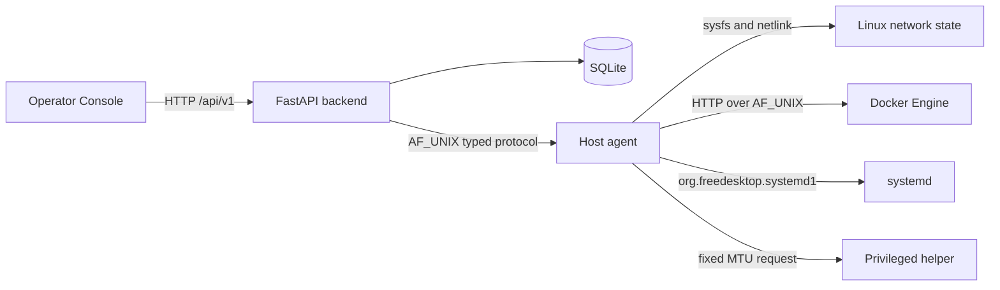
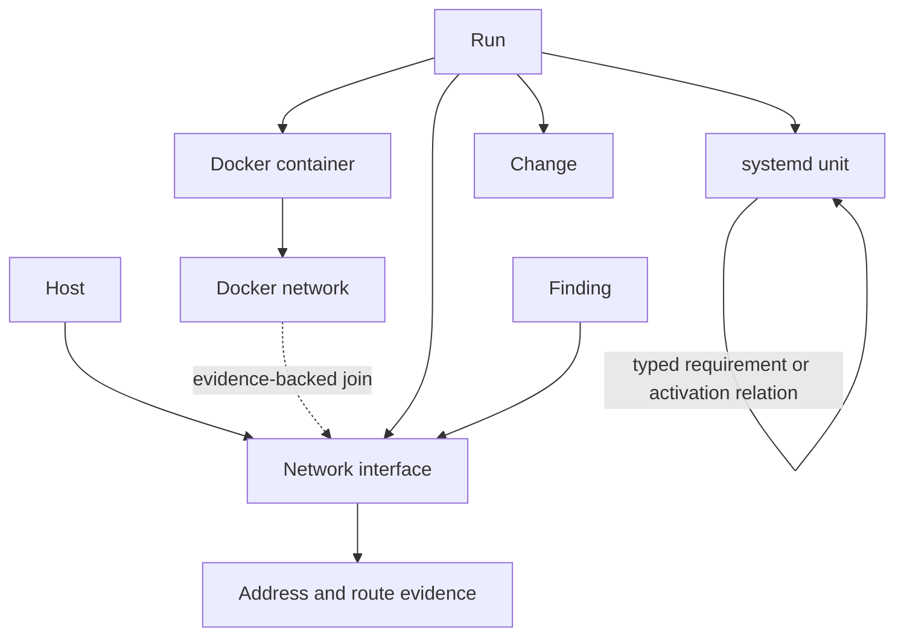

# API and topology

[Back to the repository overview](../README.md)

The HTTP API exposes LocalPlane's normalized operational model. It does not provide generic
access to provider protocols, and this document does not duplicate the generated schema.

For exact paths, request bodies, response fields, and enums, use the committed
[OpenAPI snapshot](../web/openapi.json) or run the backend and open `/docs`.

## Current topology

The console calls `/api/v1` on its own origin. In development, Vite proxies `/api` to the
loopback backend because the backend has no CORS middleware. The proxy is a development
convenience, not a security boundary.

## Authentication

Every current user-facing API operation requires authentication. Automation and API clients send
`Authorization: Bearer <master-secret>`. `POST /api/v1/session` requires that master Bearer and
returns a derived browser session only through `Set-Cookie`; `GET /api/v1/session` reports bounded
session state, and cookie-authenticated `DELETE /api/v1/session` revokes it.

Ordinary operations accept either the master Bearer or a valid browser cookie. Cookie-authenticated
POST, PUT, PATCH, and DELETE require an exact same-origin value, with at most one configured Vite
development origin. Missing and foreign origins fail with 403. Bearer calls do not require Origin.
`/docs`, `/redoc`, and `/openapi.json` are protected too. Authentication identifies no person and
does not replace the Change Engine or provider/privilege safety boundaries.

## API domains

| Domain | Purpose |
| --- | --- |
| Status, host, agent | Backend status, stored host identity, agent connectivity, and agent-cached capabilities |
| Network | Stored interfaces, evidence, provenance, protection, intent, reconciliation, and refresh |
| Docker | Stored containers plus explicit refresh, bounded log reads, and current statistics |
| systemd | Stored loaded units plus explicit bounded inventory refresh |
| Management path | Request-scoped connection/route evidence and stored protection context |
| Observations | Sweep history and completeness |
| Findings | Durable drift and ownership-conflict records |
| Runs | Create, inspect, preview, confirm, apply, keep a guard, cancel, and grant a bounded self-impact override |
| Changes | Inspect mutation history and unresolved recovery holds; confirm, retry, or resolve recovery through separate endpoints |

The committed OpenAPI document defines the supported routes for this pre-release snapshot;
it is not a long-term compatibility guarantee.

## Reads, observations, and records

Most `GET` routes read stored state and never contact the host. Provider observation is
explicit so a response can distinguish a stored fact from a new read:

- `POST /network/observations/refresh`
- `POST /docker/containers/observations/refresh`
- `POST /systemd/observations/refresh`
- `POST /management-path/observations/refresh`

Filesystem observations, container logs/statistics and service journal reads also use `POST`.
They collect on demand, not as a side effect of navigation or the console's global stored-record
reread. Content reads retain their separate acknowledgment boundary. Filesystem evidence and
container samples are transient; a new read does not establish retained inventory membership.

`GET /agent` and `GET /agent/capabilities` are exceptions to store-only GET behavior: they
perform a handshake and record identity and the agent's cached capability evidence. A handshake
does not rediscover provider capabilities or refresh inventories. The console dates these checks
separately and excludes them from the global stored-record reread.

`GET /changes/recovery-holds` is a pure stored read. Its `total_count` counts all unresolved
holds, independently of the bounded `changes` list; `count`, `limit` and `truncated` describe
the displayed page. A later release does not rewrite a Change's original recovery-required
outcome, but excludes it from this unresolved-hold result.

Inventory `count` fields count retained records, not necessarily current provider objects.
`observed_in_latest_sweep` states membership in the latest recorded inventory, independently
of each observation's age and fidelity. Partial or failed collection does not prove absence.
Each sweep also publishes its own `freshness` and `age_seconds` under the configured backend
TTL. Fresh targeted object evidence cannot make an older full inventory current, including an
inventory that returned no objects.
The console preserves history and qualifies relationship counterparts with this evidence.

Address `valid_lifetime_state` and `preferred_lifetime_state` distinguish `unknown`, `finite`
and `infinite`; the corresponding nullable seconds retain finite zero. Only an explicit kernel
infinite sentinel establishes no expiry. Older null lifetimes without that distinction remain
unknown until observed again; they cannot be safely backfilled as infinite.

Adoption, release, intent revision, Run creation/confirmation/cancellation, recovery
confirmation/resolution, and the self-impact override change LocalPlane records only.

Only `POST /runs/{id}/apply` and `POST /changes/{id}/recovery/retry` can result in a host
write. See the [safety model](safety-model.md).

## Object and relationship topology

Relationships use authoritative identifiers and typed provider evidence. Docker bridge
relationships join on network IDs and published IPAM/link evidence, not display names.
systemd preserves distinctions between requirements, ordering, conflicts, activation, and
outcome handling. Ordering is not treated as dependency.

A target may be current, referenced but not observed, external to the bounded inventory, or
unresolved. The API retains that distinction instead of fabricating a complete graph.

## Console coverage

The console consumes the integrated contract for overview, network, Docker, systemd,
management-path evidence, sweeps, findings, Runs and Changes. Explicit inventory observation
is followed by a stored-record reread; if that reread fails it can be retried without collecting
again. Observation and stored-read failures remain separate from the age of retained facts.
The existing guarded Composer binds only systemd service start/stop/restart. Hold-resolution,
Docker lifecycle and broader configuration controls are not exposed by this refresh workflow.
Topology renders only evidence-backed, membership-qualified relationships and identifies
missing coverage rather than inferring that there are no objects.

The V4.2 image in the repository overview includes directional surfaces with no current
contract. It must not be used to infer API or topology support.

## Contract workflow

`web/openapi.json` is the committed backend snapshot and
`web/src/api/schema.d.ts` is generated from it. When the backend contract changes, refresh
both from the same running backend and review the pair together. Commands and safety notes
are in [Development](development.md#openapi-and-generated-types).
